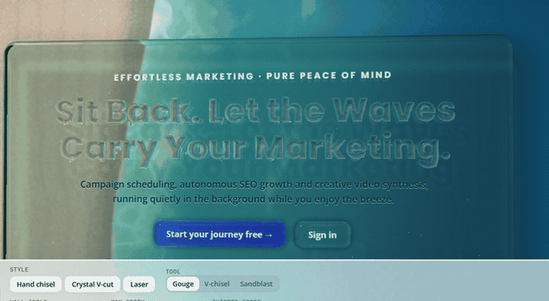
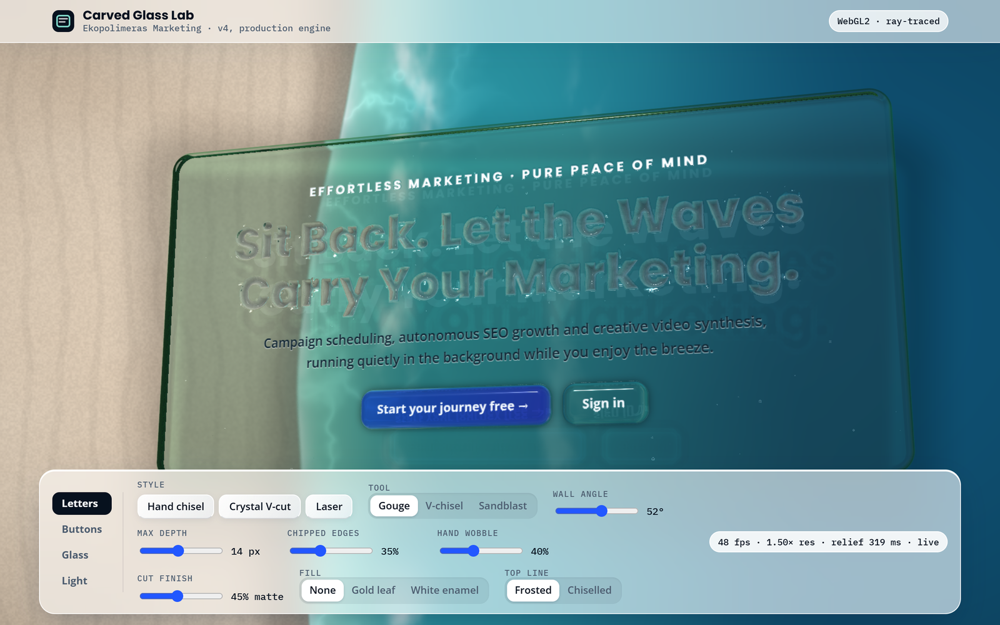
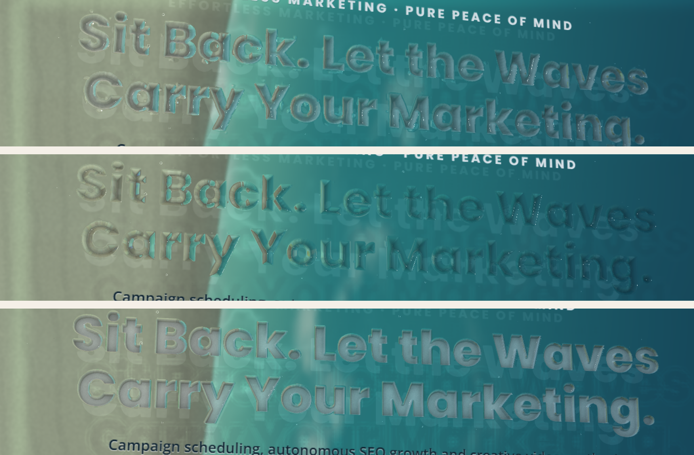
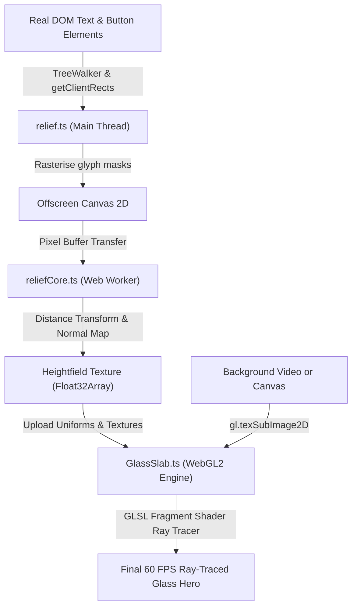
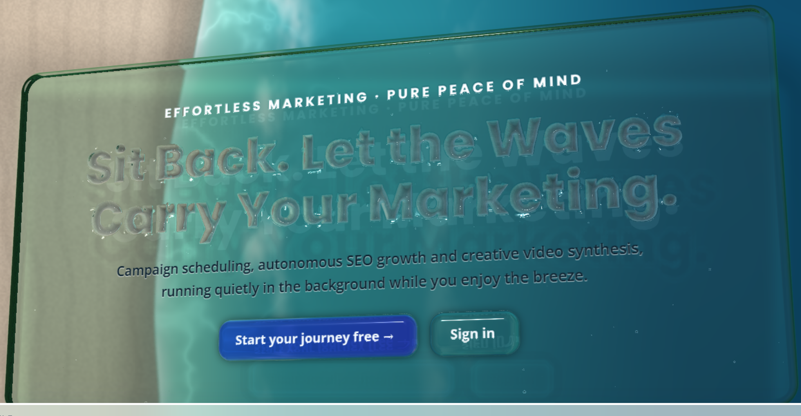
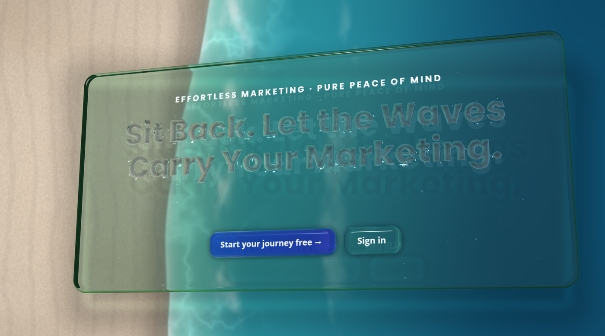

# Glass Slab ✦ Ray-Traced Carved Glass Hero

[](https://developer.mozilla.org/en-US/docs/Web/API/WebGL2RenderingContext)
[](https://www.typescriptlang.org/)
[](https://react.dev/)
[](https://github.com/Kausiukas/glass)
[](https://github.com/Kausiukas/glass)

A real-time, ray-traced carved-glass hero card built in **WebGL2** and plain **TypeScript**, with an optional **React 18** wrapper. 

Every pixel follows an optical ray through a physical glass block: entering the front face or letter bevel, traveling through the volumetric glass with absorption and chromatic dispersion, reflecting off surfaces, and refracting onto the background video or canvas beneath.



*Live interactive WebGL2 ray tracing with physical tilt, caustics, and real-time Snell's law refraction ([watch MP4](assets/demo.mp4)).*

---

## ✨ Features

- **Physically Inspired Optics**: True volumetric ray tracing with Snell's law refraction, internal reflections, caustic edge highlights, and physical dispersion.
- **Accessible & Selectable**: The HTML text remains 100% real DOM markup. Text is selectable, indexable by search engines, and fully accessible to screen readers.
- **Dynamic Letter Chiselling**: Measures typography dynamically via `TreeWalker` and generates signed-distance heightfields in a background Web Worker.
- **Raised Glass Buttons**: Interactive, clickable HTML buttons rendered as 3D raised glass with pillow or bevel shapes and dynamic hover feedback.
- **Interactive Tuning Lab**: Double-click `carved-glass-lab.html` in any modern browser—no server, npm install, or build step required.
- **Zero Runtime Dependencies**: The core engine is lightweight, vanilla TypeScript and GLSL. React is only needed if using the `<GlassHero>` wrapper component.

---

## 🔬 Interactive Tuning Lab

The project includes a self-contained tuning laboratory (`carved-glass-lab.html`) where you can tweak every optical and sculptural setting in real time and export still images.



Open `carved-glass-lab.html` directly in Chrome, Edge, Safari, or Firefox to experiment with:
- **Glass Optics**: Slab thickness, surface frost, glass tint (float, clear, sea), index of refraction (IOR), sun angle, and caustics.
- **Carving Tools**: Chiselling depth, bevel angle, artisanal chips, edge wobble, and surface finish.
- **Interactive Stills**: Export 2× high-resolution transparent PNG stills directly with `renderStill()`.

---

## 🎨 Carving Profiles & Presets

The engine supports distinct physical tool geometries for letter carving:



| Profile | Tool Geometry | Wall Angle | Aesthetic |
|---|---|---|---|
| **Hand Gouge** | Rounded gouge with chip noise | 52° | Organic, artisanal masonry chisel with natural micro-wobble and stone chips. |
| **Crystal Vee** | Sharp prismatic V-cut | 46° | Faceted luxury crystal with crisp specular highlights and high internal reflections. |
| **Laser Sand** | Sandblasted steep cut | 80° | Ultra-precise contemporary frosted relief with high contrast. |

---

## 🏗 Architecture Pipeline



---

## 🖼 High-Resolution Stills & Posters

Need a poster image, social preview card, or instant no-WebGL fallback? Call `renderStill()` on the engine instance:

```ts
const pngBlob = await engine.renderStill({ scale: 2, crop: "slab" });
const url = URL.createObjectURL(pngBlob);
```

<p align="center">
  
  
</p>

---

## 🚀 Quick Start

### 1. React + Tailwind CSS (v4)

Wrap your hero markup in `<GlassHero>`:

```tsx
import { GlassHero } from "./glass/GlassHero";

export function SiteHero() {
  return (
    <div className="relative min-h-screen overflow-hidden">
      {/* Background Video */}
      <video
        id="bg-video"
        className="absolute inset-0 w-full h-full object-cover z-0"
        src="/beach-loop.webm"
        autoPlay
        muted
        loop
        playsInline
      />

      {/* Ray-traced Hero Slab */}
      <div className="relative z-10 flex items-center justify-center min-h-screen p-6">
        <GlassHero
          background={() => document.getElementById("bg-video") as HTMLVideoElement | null}
          options={{ thickness: 44, tool: "gouge", frost: 0.14 }}
          slabClassName="w-full max-w-[920px] px-14 py-16 rounded-[28px]"
        >
          <p data-glass-carve data-glass-small>Effortless Marketing · Pure Peace of Mind</p>
          <h1 data-glass-carve>Sit Back. Let the Waves Carry Your Marketing.</h1>
          <p>The words you read are chiselled into a real ray-traced block of glass.</p>
          <div className="flex gap-4 mt-6">
            <a href="/signup" data-glass-button="1">
              <span data-glass-label>Start your journey free →</span>
            </a>
            <a href="/login" data-glass-button="2">
              <span data-glass-label>Sign in</span>
            </a>
          </div>
        </GlassHero>
      </div>
    </div>
  );
}
```

### 2. Vanilla JavaScript / Framework-Agnostic

Use the prebuilt bundle from `dist/`:

```html
<script src="dist/glass-slab.iife.js"></script>
<script>
  const engine = new GlassSlabLib.GlassSlab({
    canvas: document.getElementById("gl-canvas"),
    host: document.getElementById("slab-host"),
    slab: document.getElementById("slab-content"),
    background: "beach", // or HTMLVideoElement
    options: {
      thickness: 44,
      tool: "gouge",
      glass: "float"
    }
  });

  engine.start();
</script>
```

---

## ⚙️ Configuration Reference

| Parameter | Type | Default | Description |
|---|---|---|---|
| `thickness` | `number` | `44` | Physical glass slab thickness in pixels (10–120 px). |
| `frost` | `number` | `0.14` | Roughness / sandblasting frost on the front face (0 = polished, 1 = frosted). |
| `glass` | `"float" \| "clear" \| "sea"` | `"float"` | Optical body color absorption profile. |
| `ior` | `number` | `1.5` | Index of refraction (1.1 = water-like, 1.5 = crown glass, 1.8 = flint). |
| `dispersion` | `number` | `0.35` | Chromatic dispersion split across color spectrum rays. |
| `caustics` | `number` | `0.4` | Intensity of internal caustic light convergence rays. |
| `tool` | `"gouge" \| "vee" \| "sand"` | `"gouge"` | Chiselling tool profile for letters. |
| `wallAngle` | `number` | `52` | Cut wall steepness in degrees (30°–85°). |
| `maxDepth` | `number` | `14` | Maximum chiselling penetration depth in pixels. |
| `chips` | `number` | `0.35` | Micro-chip roughness along cut bevel edges. |
| `wobble` | `number` | `0.4` | Organic stonemason tool oscillation and path variance. |
| `buttonShape` | `"pillow" \| "bevel"` | `"pillow"` | 3D glass shape for raised interactive buttons. |

---

## 🛠 Project Structure & Build

```
glass/
├── assets/                     # High-res screenshots, diagrams, and renders
├── carved-glass-lab.html       # Standalone interactive tuning lab
├── HANDOVER.md                 # In-depth 600-line engineering specification
├── README.md                   # Project overview & documentation
├── src/glass/                  # Core engine source files
│   ├── GlassSlab.ts            # WebGL setup, render loop, event orchestration
│   ├── GlassHero.tsx           # React 18 wrapper component
│   ├── shaders.ts              # GLSL fragment ray tracer and background blit
│   ├── reliefCore.ts           # Signed distance field math (runs in worker)
│   ├── relief.ts               # DOM typography & button rasterizer
│   ├── relief.worker.ts        # Web Worker entrypoint
│   └── options.ts              # Parameter defaults and color definitions
├── examples/                   # React + Tailwind and Vanilla HTML examples
├── dist/                       # Prebuilt ESM, IIFE, and Worker distributions
└── lab/                        # Sources for building carved-glass-lab.html
```

### Build Commands

```bash
# Install development dependencies
npm install

# Type-check TypeScript code
npm run typecheck

# Rebuild dist bundles and carved-glass-lab.html
npm run build
```

---

## 📖 In-Depth Specification

For complete details on optical formulas, ray marching derivations, worker communication protocols, and performance considerations, read **[`HANDOVER.md`](HANDOVER.md)**.

---

## 📄 License

MIT © [Antanas Valčiukas](https://github.com/Kausiukas)
